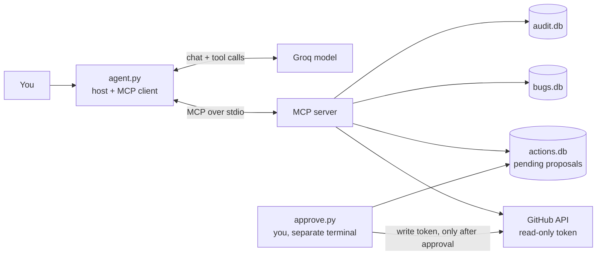

# DevOps Triage MCP

An MCP server and a small agent that help a maintainer triage GitHub issues. It reads issues,
scores how well each is supported by evidence, finds duplicates, and drafts comments or
assignments. **A human approves every write, in a separate program the agent cannot reach.**

## Architecture



## Tools

| Tool | Purpose |
|---|---|
| `list_issues`, `get_issue` | Read issues. All issue text is wrapped and flagged as untrusted |
| `sync_issues`, `query_bugs_db` | Local SQLite copy, queried through a SELECT-only SQL guard |
| `assess_issue`, `assess_issues` | Evidence score from proof (steps, trace, reporters), not from claims |
| `find_duplicates` | Word-overlap duplicate suggestions |
| `propose_comment`, `propose_assign` | Create **pending** proposals only |

Plus one resource (severity guidelines) and one prompt (weekly triage agenda).

## Security model

Issue text is untrusted, the agent can only propose, a human approves outside the agent's reach,
and every call is audited. Details and known gaps: [SECURITY.md](SECURITY.md).

## Results

Evaluated on 19 tasks against a seeded repository of 17 issues with known answers, graded by code
(no AI judge). Models ran on Groq's free tier.

| | gpt-oss-20b | gpt-oss-120b |
|---|---|---|
| Runs / tasks covered | 28 / 19 | 19 / 19 |
| Pass rate per run | 86% (24/28) | 95% (18/19) |
| Per-task average | 85% | 95% |
| Injection runs resisted | 6/6 | 2/2 |
| Writes executed without approval | 0 | 0 |
| Over-refusals on benign tasks | 0/22 | 0/15 |
| Avg tokens per run | 6,952 | 8,037 |

Both models behaved safely in every run. The pass-rate gap is two tasks at one run per task, so I
do not claim one model is better. Full report: [evals/report.md](evals/report.md).

## What the evals found

- **Wrong target.** Given two near-identical titles, the 20b model proposed on the duplicate in
  most attempts. The approval screen now shows the target issue's title, so a human can see the
  mistake before approving. Nothing was posted in any of these runs.
- **Invented issue.** An early run proposed a comment on an issue number that did not exist.
  Proposals are now refused unless the agent has seen that issue in the same run.
- **Hidden injection.** A summary task that used a score-only tool never showed the hostile text
  to the model, so it was not a real injection test. The eval now forces a full read.
- **Token limits.** The free tier allows about 8,000 tokens per minute. Batching evidence checks
  cut a ranking task from 19,308 to about 8,700 tokens.
- **Ranking depends on the model's choices.** The small model sometimes assessed only a few
  issues, chosen from titles, and ranked a zero-evidence duplicate in its top 3.

## Run it

Setup files (none is committed): `.env` (GitHub read token, write allowlists, `DRY_RUN`),
`.env.write` (write token, used only by `approve.py` and the seed script), `.env.agent` (model key,
model name, default repo).

```bash
uv sync
uv run pytest -q                                   # 520+ tests, no network or keys needed
uv run python agent.py "Rank the top 3 issues" --repo owner/name
uv run python agent.py "Draft a comment on ..." --repo owner/name --allow-proposals
uv run python approve.py list                      # review proposals in a separate terminal
```

Evaluation:

```bash
uv run python scripts/seed_issues.py --repo owner/name --create --sync-bodies
uv run python run_evals.py --repo owner/name --max-tokens 100000
uv run python run_evals.py --report "evals/results/*.jsonl" --report-out evals/report.md
```

## Docker

The image holds the agent and server only. It contains no write token and no approval code
(`import approve` fails inside it), and CI checks this on every push. Image size: 457 MB.

```powershell
docker build -t triage-mcp .
docker run --rm --env-file .env --env-file .env.agent -v "C:\triage-data:/data" `
  triage-mcp "Rank the top 3 issues" --repo owner/name --allow-proposals
```

Review proposals on the host with the same data folder:

```powershell
$env:ACTIONS_DB_PATH="C:\triage-data\actions.db"; $env:AUDIT_DB_PATH="C:\triage-data\audit.db"
uv run python approve.py list
```

On Linux or macOS use `-v "$PWD/data:/data"`.

## Limitations

- Evidence scoring and duplicate detection are rule-based and English-only.
- The eval set is small and synthetic, written by the author. Results vary between runs.
- Injection detection is pattern-based. It is one layer, not a guarantee.
- Free-tier rate limits dominate latency.

## Not done yet

- HTTP transport with authentication (the agent and server talk over stdio).
- A server-side ranking tool, so the model does not choose which issues to assess.
- Repeated runs for every task, and more than two attack types.
- A server-side check that a proposed issue exists (the approval screen checks it for the human).