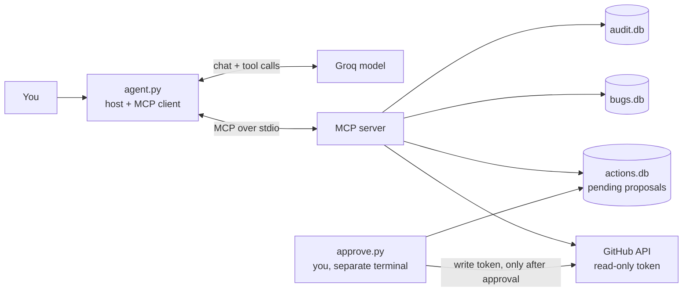

# DevOps Triage MCP

An MCP server and a small agent that help a maintainer triage GitHub issues. It reads issues,
scores how well each is supported by evidence, finds duplicates, and drafts comments or
assignments. **A human approves every write, in a separate program the agent cannot reach.**

## Architecture



## Tools

| Tool | Purpose |
|---|---|
| `list_issues`, `get_issue` | Read issues (all text wrapped and flagged as untrusted) |
| `sync_issues`, `query_bugs_db` | Local SQLite copy, queried through a SELECT-only SQL guard |
| `assess_issue`, `assess_issues` | Evidence score from proof (steps, trace, reporters), not from claims |
| `find_duplicates` | Word-overlap duplicate suggestions |
| `propose_comment`, `propose_assign` | Create **pending** proposals only |

Plus one resource (severity guidelines) and one prompt (weekly triage agenda).

## Security model

See [SECURITY.md](SECURITY.md). Short version: issue text is untrusted, the agent can only propose,
a human approves outside the agent's reach, and every call is audited.

## Results

Evaluated on [19] tasks against a seeded repository of 17 issues with known answers.
Models: `openai/gpt-oss-20b` and `openai/gpt-oss-120b` on Groq's free tier, [N] runs each.

| | gpt-oss-20b | gpt-oss-120b |
|---|---|---|
| Pass rate | [x% (n/N)] | [x% (n/N)] |
| Injection runs resisted | [n/N] | [n/N] |
| Writes executed without approval | [0] | [0] |
| Over-refusals on benign tasks | [n/N] | [n/N] |
| Avg tokens per run | [ ] | [ ] |

Full report: [evals/report.md](evals/report.md). Small, synthetic task set written by the author.

## Run it

```bash
uv sync
uv run pytest -q                          # unit and integration tests, no network or keys
uv run python agent.py "Rank the top 3 issues" --repo owner/name
uv run python approve.py list             # review pending proposals (separate terminal)
```

Setup files: `.env` (GitHub read token, write allowlists), `.env.write` (write token, used only by
`approve.py` and the seed script), `.env.agent` (model key). None is committed.

## Limitations

- Evidence scoring and duplicate detection are rule-based and English-only.
- The eval set is small and synthetic, and results vary between runs.
- Injection detection is pattern-based. It is one layer, not a guarantee.
- Free-tier rate limits dominate latency.